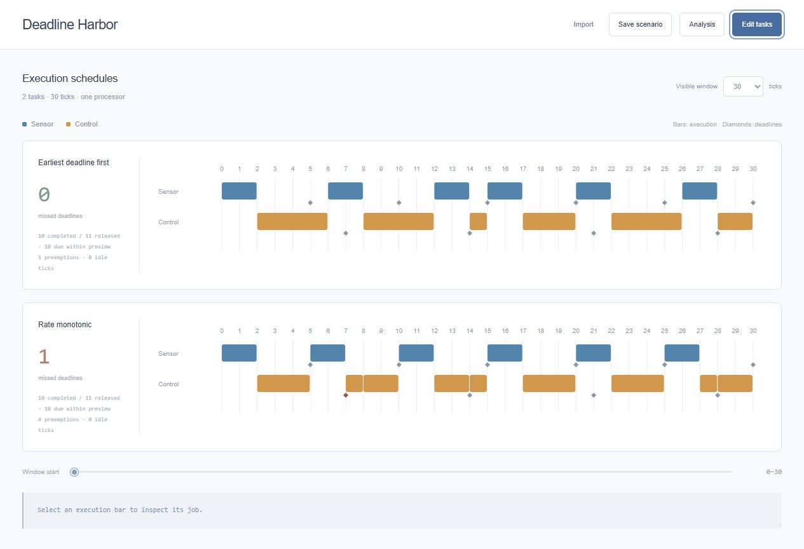

# Deadline Harbor

A real-time scheduling workbench for periodic workloads on one preemptive processor. Edit periodic tasks, compare earliest-deadline-first (EDF) with rate-monotonic (RM) scheduling, inspect execution timelines, and distinguish a finite preview from schedulability analysis.



## Run

Python 3.10+; no dependencies or build step:

```sh
python run.py
```

Open http://127.0.0.1:8000. Computation runs in a browser worker. The Python server serves only the app's static assets on loopback, and documents never leave the browser.

## Interface

EDF and RM execution timelines appear together with a shared time window. Select a bar in either timeline to inspect that policy’s job. Task editing opens in a dialog; schedulability proofs, response-time iterations, and the filtered job ledger are available under Analysis. The charts resize with the window and scroll horizontally on narrow screens to keep tick labels readable.

## Workflows

- Define 1–8 tasks with integer execution time, period, relative deadline, and initial release offset. Use `1 ≤ execution ≤ deadline ≤ period ≤ 200` and `0 ≤ offset < period`.
- Simulate up to 2,000 ticks under both policies. Compare misses, completions, preemptions, and idle time.
- Browse 30/60/120-tick windows. Execution bars are keyboard-accessible; selecting one reveals the job's release, absolute deadline, start, completion, response time, and remaining work. Diamonds mark deadlines; red diamonds were missed.
- Filter the ledger for missed or unfinished jobs. The view caps at 200 rows; CSV exports every released job for the selected policy.
- Save/import a scenario or export a complete JSON report with jobs, execution segments, events, analytical results, and response-time iterations.

The default task set uses 2/5 and 4/7 execution/period pairs. EDF succeeds while RM misses a deadline. The tight-deadline example has only 58.33% utilization but demands four ticks before time three, making it infeasible. These examples show why utilization alone and a single simulation are insufficient evidence.

## Model and algorithms

The model assumes one fully preemptive processor, independent periodic tasks, execution equal to supplied WCET, integer timing, and zero blocking, jitter, context-switch cost, and other overhead. It does not model an actual RTOS or certify a physical system.

At time `t`, jobs release, the highest-priority ready job runs over `[t,t+1)`, completion is recorded, and deadlines at `t+1` are checked. Completion exactly at a deadline succeeds. Releases at the preview horizon are excluded. Missed jobs continue to consume CPU and are marked overdue or late. A job whose deadline lies beyond the preview is pending, not missed. A preemption is a switch away from an unfinished running job; ordinary completion/idle transitions are not counted.

EDF orders by absolute deadline, then task order, then release. RM orders by period, then task order, then release. Equal-period priorities therefore remain fixed. The time-step simulation intentionally favors inspectable semantics over a heap-based large-scale engine.

### Separate schedulability checks

RM iterates `R = C + Σ ceil(R / T_h) C_h` over higher-priority tasks, starting at the task's own execution time. It stops at a fixed point or as soon as the relative deadline is exceeded. The displayed failed value is the first exceeding iterate, not a claimed exact response time.

EDF evaluates `Σ max(0, floor((t-D)/T)+1) C ≤ t` at deadline checkpoints through one hyperperiod. Utilization above 100% fails immediately. A hyperperiod over 200,000 ticks returns **inconclusive**, never an assumed pass. Integer periods and constrained deadlines make this bounded checkpoint test applicable.

For all-zero offsets, these tests characterize this scheduling model. For staggered offsets, a passing synchronous worst-case bound remains sufficient; a failed synchronous bound is labeled **not-proven**, because that particular offset pattern may still work. Long-run utilization above one fails regardless of offsets. The simulation honors the actual offsets separately.

## Verification

Node.js 22+ is needed only for development checks:

```sh
npm test
npm run check
python -m unittest discover -s tests -p "test_*.py"
```

12 JavaScript tests include 400 generated finite workloads checked against an independent bipartite job-to-slot matching oracle; 150 synchronous task sets comparing analytical decisions with full-hyperperiod simulations; exact-deadline and horizon boundaries; offset qualification; overload and analysis limits; response-time recurrence; timeline conservation; preemption counting; deterministic exports and validation. One Python test covers static route boundaries, HEAD, Host validation, and content security policy. CI covers Linux and Windows.

Browser checks exercised task edits, demand-bound counterexamples, interactive late-job inspection, filtered ledgers, and JSON report downloads. The downloaded report's timeline and demand witness were independently checked outside the browser.

## Background

- [Baruah and Ekberg, ECRTS 2023](https://drops.dagstuhl.de/storage/00lipics/lipics-vol262-ecrts2023/LIPIcs.ECRTS.2023.2/LIPIcs.ECRTS.2023.2.pdf), Section 2.1: processor-demand analysis and deadline testing sets through the hyperperiod.
- [Davis, Zabos, and Burns, University of York](https://www.cs.york.ac.uk/rts/publications/Davis2007b.html): exact response-time analysis for fixed-priority preemptive systems.
